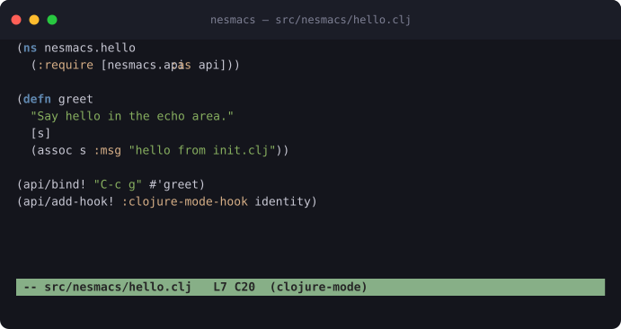

# nesmacs

**Emacs' editing model, rebuilt in Clojure — and rewritable while it runs.**

[](LICENSE)


Buffers, windows, key prefixes, mark, kill ring, modes and hooks — on a small
Clojure core. No Elisp runtime and no plugin boundary: configuration, commands
and fontification are Clojure in the same process as the editor, so the editor
is something you can inspect, change and debug while it is running.



<p align="center"><sub>Rendered by <code>nesmacs.view</code> from a real editor state — no mockup.</sub></p>

## Install

```sh
curl -fsSL https://raw.githubusercontent.com/nez/nesmacs/main/install.sh | sh
```

Needs Java 17+, `tmux` 3.0+, `git` and `ripgrep` on `PATH`. The script checks
them and installs nothing system-wide; it puts `nesmacs.jar` and a launcher
under `~/.local` (override with `--prefix DIR`, or pin a release with
`--version TAG`) and prints the `PATH` line if it is missing. `--uninstall`
removes the jar and launcher.

Run `nesmacs path/to/file.clj` to open a file directly. Pass several paths to
open them in separate buffers with the first file visible.

`C-x C-c` closes the focused pane when there is a split. With one pane it asks
to save modified files before exiting. `M-x quit-editor` exits with any layout.
Scratch buffers stay in the session. First launch creates `~/.nesmacs/` for
config, session and the crash journal.

From a checkout, `./install.sh` uses `target/nesmacs.jar` or builds it with the
Clojure CLI. `make setup` is the contributor bootstrap (Clojure CLI, linter,
dev dependencies). `make run` rebuilds the AOT jar only when sources changed and
runs it (~1.5 s); `./nesmacs` runs the existing jar. `make dev` loads source
instead, so it starts in ~4 s but picks up edits without a restart.

Your fingers already work: `C-f C-b C-n C-p C-a C-e`, `C-s`, `M-%`, `C-x C-f`,
`C-x C-s`, `C-x 2`, `C-x o`, `M-x`, `M-:`. Beyond those: `C-x g` git status,
`C-x p g` ripgrep the project, `M-.` definition, `C-c h` hover, `C-c i`
complete symbol, `C-x r` registers and rectangles, and `C-c t` opens a
terminal. `Esc Esc Esc` cancels the current editor prompt, key prefix, or search.

Drag a split divider with the left mouse button in the terminal or browser.
`C-x o` (`M-x other-window`) focuses the next pane. `C-x b`
(`M-x switch-to-buffer`) chooses the buffer shown in that pane.
`C-x 0` (`M-x delete-window`) closes the pane and keeps its buffer open.
`C-x k` closes a buffer and asks what to do with unsaved edits. `C-x C-s`
reports a conflict if the file has changed on disk since it was opened or saved.

Real terminals are core: `C-c t` runs `$SHELL` in a tmux session, so the shell
(outside the editor) survives an editor exit or crash and reattaches next start.
`C-c C-c` interrupts, `C-c C-k` kills the buffer and session, `C-c C-r`
restarts and `C-c M-x` reaches `M-x`. While the terminal has focus, use
`C-c C-x o` for the next pane, `C-c C-x b` to choose a buffer, or
`C-c C-x 0` to close the pane. `C-c C-x C-c` closes the focused pane in a
split or exits with one pane. `C-c C-q` exits with any layout.
Clicking a terminal pane focuses it. The shell receives keyboard input.

## The part that is different

The editor is one atom. Every command is a pure function from that state to the
next one. That is not an implementation detail — it is the feature:

```clojure
;; Connect to the editor's nREPL from CIDER/Calva or another terminal.
;; The default port is 7888. The last launch writes its actual port to
;; ~/.nesmacs/nrepl-port.edn.
user=> (require '[nesmacs.ed :as ed] '[nesmacs.cmd :as cmd])
user=> (str (:text (cmd/cur @ed/editor)))
"(ns nesmacs.hello\n  (:require [nesmacs.api :as api]))\n..."
user=> (swap! ed/editor cmd/edit 0 0 ";; live from the REPL\n")
;; the buffer on screen is now different
```

Press `M-:`, paste this form, and press `RET`. Then press `C-c e` to see
`Hello from nesmacs` in the echo area.

```clojure
(nesmacs.api/bind! "C-c e" (fn [s] (assoc s :msg "Hello from nesmacs")))
```

With Nesmacs running, open <http://127.0.0.1:1234> for the local web client.
Browser and terminal share the buffers and command loop. Each browser tab
fits its own viewport and reconnects if the editor restarts. The browser
assets are packaged in the jar. Set `NESMACS_WEB_PORT` before launch to use
another local port. Use the browser's Paste action (`Ctrl+Shift+V` or
`Cmd+V` in Chrome) to paste from the system clipboard. For browser-reserved
shortcuts such as `Ctrl+W`, use the equivalent command (`M-x kill-region`).

The rest follows from the same decision:

- **Crash-safe by construction.** Every edit appends a small journal record
  before the next key is read. `kill -9` loses at most the command in flight;
  restart replays the journal. There is a pty test that edits, kills the JVM,
  restarts, and requires the text back.
- **One painter.** The region, search matches, LSP diagnostics and diff faces
  are all durable `[from to)` props with a face and a priority. They follow
  edits until the text they cover disappears. Fontification is derived per
  line, cached, and pruned to the viewport, so an edit only drops the lines it
  can affect.
- **No plugin API to learn first.** If the editor can do it, it is a function
  you can call: `(swap! ed/editor ed/find-file "src/nesmacs/ed.clj")`.

## What is in the box

- **Editing** — persistent char-array text with a line index, Unicode and
  wide-character aware
  cursor math, undo/redo with adjacent inserts coalesced, bracketed paste as
  one edit, mouse clicks that move point, OSC 52 copy so kills reach the
  system clipboard (even over SSH).
- **Finding** — incremental search, query-replace, occur, imenu, goto-line,
  window tree with splits and resizing, project search via ripgrep streamed
  into a buffer.
- **Files and projects** — find-file, dired, buffer list, recentf, bookmarks,
  registers, rectangles, project find-file.
- **Programs** — `M-!` and `M-|` are jobs: output streams into a buffer while
  typing stays responsive, `C-c C-k` kills, `g` reruns.
- **HTTP** — `M-x http` opens `*HTTP*`; the request sits above the first
  blank line, `C-c C-c` sends it and writes the response below. The second
  non-editor app built from the same primitives: a buffer, a mode keymap and
  a command.
- **Git** — `C-x g` status with stage/unstage, diff, log and commit. Diff and
  log buffers are ordinary buffers with faces and navigation. `C-x v b` blame,
  `C-x v s`/`C-x v u` stage or unstage one hunk through `git apply --cached`,
  `C-x v p` lists pull/merge requests via `gh` or `glab`.
- **Languages** — one registry (`nesmacs.lang`) maps extension to mode, comment
  syntax, formatter, language server, Tree-sitter grammar and query set.
  Clojure/EDN, Python, JavaScript, TypeScript and TSX highlight through
  vendored nvim-treesitter queries, with the line tokenizer as fallback.
  `C-c TAB` folds, `C-c f` formats.
- **LSP** — diagnostics as props, `M-.` definition, `C-c h` hover, `C-c i`
  symbol completion (honouring `textEdit` and snippets), `C-c r` references,
  `C-c R` rename, `C-c a` code actions, `C-c g` signature help, `C-c m`
  document symbols, `C-c f`/`C-c F` format buffer/region. One server per
  project root and language. Install the server on `PATH` (e.g. `clojure-lsp`
  for Clojure) and it starts on demand.
- **Debugging** — `C-c d d` starts the language's DAP adapter (debugpy,
  vscode-js-debug; Clojure keeps nREPL). `C-c d b` toggles a gutter
  breakpoint, `c`/`n`/`i`/`o` resume and step, `s`/`v` show frames and locals,
  `e` evaluates in the stopped frame, `q` disconnects. Adapters are data in
  `nesmacs.lang`; `make dap` runs the live debugpy and vscode-js-debug tests.
- **Tests** — `M-x run-tests` runs the project's command as a job and parses
  JUnit XML or TAP into `*Test Results*`; RET jumps to a failure. Runners with
  their own format still yield jumpable entries from `file:line` lines.
- **Durability** — session restore for buffers, windows, points and props;
  per-command journal; auto-save with a recovery prompt; safe quit dialog.
- **Rendering** — one named face map with two palettes (`M-x load-theme`:
  `default`, `light`) plus `api/set-face!` for one-off tweaks; durable props,
  incremental font-lock, a one-column gutter for breakpoints and the stopped
  line, large-file mode above 1 MB or 100k lines (the region still paints
  there).
- **AI assistance** — `M-x agent` opens the configured CLI (`$NESMACS_AGENT`, or
  `claude`) in a normal terminal buffer. The editor has no API client.

**Extensions** can add Clojure commands, modes, key bindings, and hooks. Forge
and HTTP Client ship as enabled packages. Open `M-x hub` in the terminal or
web client to manage them and explore other packages. Press `s` to choose a
catalog URL or file. Extension changes take effect at the next startup. See
the [example catalog and package format](extensions/README.md).

## Configure it in Clojure

`~/.nesmacs/init.clj` runs at startup, after the previous session is restored.
`M-x reload-config` re-evaluates it without restarting.

```clojure
(ns my.init
  (:require [nesmacs.api :as api]))

(defn greet
  "Say hello in the echo area."
  [s] (assoc s :msg "hello from init.clj"))

(api/bind! "C-c e" #'greet)               ; named commands also appear in M-x

(api/register-mode! :notes-mode :major
  {"C-c C-c" (fn [s] (assoc s :msg "noted"))})

(api/add-hook! :clojure-mode-hook
  (fn [s] s))
```

A failing `init.clj` reports in the echo area and the editor keeps running.
Text properties are public too: `(api/add-prop! 0 12 :match {:owner :demo})`,
`(api/set-prop! :hover 20 30 :builtin)`, `(api/remove-prop! :demo)` — the same
durable ranges search and diagnostics use.

## Work in a project

`C-x p p` (`M-x project-open`) opens or switches to a project directory. Press
`RET` on an entry in the project menu. Use `C-x p m` to return to it, `C-x p t`
for tasks, `C-x p s` for LSP symbols, and `C-x p e` for problems. In the
problems buffer, `RET` visits a source location, `a` opens code actions for an
LSP diagnostic and `g` refreshes diagnostics. `M-x jump-back` and
`M-x jump-forward` move through source visits. Multi-file LSP changes open a
review buffer with `y` to apply and `q` to cancel.
When editing in a project, LSP can show a quiet completion suggestion after
a pause. Press `C-c .` to accept it or `C-c i` to open the usual picker.

An optional `.nesmacs.edn` in the project root describes commands and working
directories. Tasks run when selected. This checkout ships with `test`, `lint`,
`check` and `build`. A profile can also define an interactive task.

```clojure
{:tasks {:test {:argv ["make" "test"] :report :tests}
         :lint {:argv ["make" "lint"]}
         :shell {:argv ["sh"] :interactive true}}
 :repl {:argv ["clojure" "-M" "-m" "nrepl.cmdline" "--port" "0"]}
 :format-on-save false}
```

A task can set `:cwd` relative to the project root and `:env` as a map of
strings. Use the argument `{file}` for the current file, `{line}` for the
current line or `{failed-files}` for the files from the project's test
failures. `project-test-file`, `project-test-at-point` and
`project-test-failed` use the `:test-file`, `:test-at-point` and `:test-failed`
tasks. The profile can choose the runner's own arguments or wrapper script.

`M-x project-debug` reads named profiles from `:launch`. For example, a Python
profile can be `{:launch {:app {:program "app.py" :args ["--dev"]}}}`. Profiles
accept `:cwd`, `:env`, `:language` and adapter-specific `:arguments`. Use
`:request :attach` with arguments for the running program, or include
`:adapter-port` to connect directly to a local DAP server. For an existing
debugpy listener, use `{:language :python :request :attach :adapter-port 5678}`
as the profile. `M-x project-repl` starts the project REPL.
`M-x project-repl-connect` selects a local nREPL
port, and `M-x project-eval-form`, `project-eval-region` and
`project-eval-buffer` evaluate source in that project. `M-x project-repl-output`
opens the output buffer.

`M-x project-git` shows branch, diff, conflict and upstream commands. Git
status still supports staging, committing and inspecting hunks.
`M-x project-status` shows language tools and tasks. User configuration and
extensions can use `api/register-project-task!`, `api/register-language!` and
the per-language arity of `api/configure-lsp!`.

## How it is built

```
read-key -> handle-key(state, key) -> next state -> render(state) -> terminal
     ^                                                                |
     '------------------------- command loop ------------------------'
```

One atom, pure commands, side effects only at the boundary. The state can be
tested, replayed from a journal, and rendered by another process.

| Module | Role |
| --- | --- |
| `nesmacs.ed` | editor core: commands, built-in keymap, modes, main loop |
| `nesmacs.buf`, `nesmacs.gap`, `nesmacs.text` | buffer type, text storage + line index, text primitives |
| `nesmacs.window`, `nesmacs.view` | window tree and layout; the only screen painter |
| `nesmacs.props`, `nesmacs.face` | durable text properties, tokenizer |
| `nesmacs.api`, `nesmacs.keymap`, `nesmacs.mode` | extension surface, key parsing, modes and hooks |
| `nesmacs.proc`, `nesmacs.job`, `nesmacs.lsp` | processes, streaming job buffers, language server |
| `nesmacs.lang`, `nesmacs.treesit`, `nesmacs.fold`, `nesmacs.format`, `nesmacs.snippet` | language registry, Tree-sitter backend, folding, CLI formatters, LSP snippets |
| `nesmacs.terminal`, `nesmacs.terminal.tmux` | terminal buffers behind a backend protocol; the tmux control-mode backend |
| `nesmacs.git*`, `nesmacs.githunk`, `nesmacs.gitblame`, `nesmacs.testres`, `nesmacs.project`, `nesmacs.dired`, `nesmacs.buflist`, `nesmacs.nav`, `nesmacs.complete` | git apps (status, log, hunk staging, blame), test reports, project search, file and buffer navigation, completion |
| `extensions/forge`, `extensions/http`, `extensions/project-notes` | Forge, HTTP Client, and Project Notes packages |
| `nesmacs.session`, `nesmacs.persist`, `nesmacs.term` | session and journal, persistence, raw terminal I/O |

Design rules live in [PRD.md](PRD.md): commands stay pure, one atom, one
rendering pipeline, one keymap mechanism, no second process model. A shortcut
with a known limit carries a `shortcut:` comment naming when to upgrade it.

## Development

```sh
make dev     # run from source
make test    # lint and editor tests
make check   # lint + tests + pty smoke + kill -9 recovery + require
make web     # live browser workflow, including Git, LSP and crash recovery
make bench   # timing gates (kept out of test so a loaded box can't fail CI)
make lsp     # live tests against clojure-lsp, pyright and typescript-language-server
make term    # terminal session test against a real tmux
make dap     # live debugger tests against debugpy and vscode-js-debug
make grammars # resolve every Tree-sitter grammar into an empty Maven repo
```

The pty scripts start the editor in a real terminal, drive it with keys and
check the rendered frame, including blame/hunk/test-report/forge list flows.
`make web` exercises the client in headless Chrome or Chromium with the real
editor, using Python's `websocket-client` and `clojure-lsp`. Set
`NESMACS_CHROME` or `NESMACS_CLOJURE_LSP` if either executable is outside
`PATH`. Set `NESMACS_WEB_JAR` to run the same checks against a built jar.
Terminal buffers are exercised end-to-end against real tmux by `make term`,
which is excluded from `make test` like the live `lsp`, `dap` and `grammars`
targets. A live target skips a server or adapter it cannot find; point
`NESMACS_CLOJURE_LSP`, `NESMACS_PYRIGHT`, `NESMACS_TSSERVER`, `NESMACS_DEBUGPY` or
`JS_DEBUG_DAP` at an install outside `PATH`.
The benchmark asserts under 50 ms per keystroke on a
100k-line file and under 2 s to open 10 MB; measured roughly 20 ms and 30 ms on
a 16-core Linux machine. Everything is testable from `clojure.test`, including
generative tests for buffers, props and text.

## Status, and when not to use it

Pre-1.0. Solid editing and text properties are done; async jobs, project
navigation, git, LSP, completion and tmux-backed terminals have working slices.
The language platform (M8: Tree-sitter highlighting and folding, with queries
vendored from nvim-treesitter under Apache-2.0, plus LSP breadth for Clojure/EDN,
Python, TypeScript and JavaScript) and the IDE workflow (M9: blame, hunk
staging, forge, test results, snippets) are implemented. M10 adds the DAP
debugger, themes, the agent CLI and the HTTP app.
[ROADMAP.md](ROADMAP.md) tracks the rest and defines 1.0: a full week as the
primary editor without falling back to another tool.

If you need org-mode, Magit, a GUI, or your existing `~/.emacs.d` today, use
Emacs — it is 40 years of work and this is not. nesmacs is for the opposite itch:
an editor small enough to read, where extending it means writing a function and
the running editor is debuggable from the REPL. No Elisp, no GUI frames, no
user native extension modules; a vetted library such as Tree-sitter sits behind
an optional backend.

Contributions are welcome. Read the milestone in [ROADMAP.md](ROADMAP.md), keep
commands pure and reach new behavior through `nesmacs.api`; data structures need
tests, terminal behavior needs a pty script.

## License

MIT — see [LICENSE](LICENSE).
