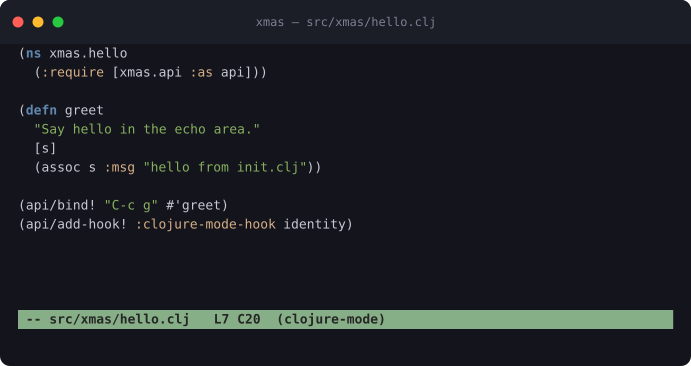

# xmas

**Emacs' editing model, rebuilt in Clojure — and rewritable while it runs.**

[](LICENSE)


Buffers, windows, key prefixes, mark, kill ring, modes and hooks — on a small
Clojure core. No Elisp runtime and no plugin boundary: configuration, commands
and fontification are Clojure in the same process as the editor, so the editor
is something you can inspect, change and debug while it is running.



<p align="center"><sub>Rendered by <code>xmas.view</code> from a real editor state — no mockup.</sub></p>

## Run it

Needs Java 11+, the [Clojure CLI](https://clojure.org/guides/install_clojure)
and a POSIX terminal. Terminals inside the editor need `tmux` 3.0+ on `PATH`.

```sh
git clone https://github.com/nez/xmas.git
cd xmas
make dev
```

That is the whole install. `C-x C-c` exits; it asks to save each modified
buffer. First launch creates `~/.xmas/` for config, session and the crash
journal. `make run` builds a jar, `./xmas` runs it.

Your fingers already work: `C-f C-b C-n C-p C-a C-e`, `C-s`, `M-%`, `C-x C-f`,
`C-x C-s`, `C-x 2`, `C-x o`, `M-x`, `M-:`. Beyond those: `C-x g` git status,
`C-x p g` ripgrep the project, `M-.` definition, `C-c h` hover, `C-c i`
complete symbol, `C-x r` registers and rectangles, and `C-c t` opens a
terminal.

Real terminals are core: `C-c t` runs `$SHELL` in a tmux session, so the shell
(outside the editor) survives an editor exit or crash and reattaches next start.
`C-c C-c` interrupts, `C-c C-k` kills the buffer and session, `C-c C-r`
restarts, `C-c M-x` reaches `M-x`, and `C-c C-x` opens the normal `C-x` map
from inside a terminal.

## The part that is different

The editor is one atom. Every command is a pure function from that state to the
next one. That is not an implementation detail — it is the feature:

```clojure
;; nREPL is on :7888. Connect from CIDER/Calva, or from another terminal:
user=> (require '[xmas.ed :as ed] '[xmas.cmd :as cmd])
user=> (str (:text (cmd/cur @ed/editor)))
"(ns xmas.hello\n  (:require [xmas.api :as api]))\n..."
user=> (swap! ed/editor cmd/edit 0 0 ";; live from the REPL\n")
;; the buffer on screen is now different
```

Or skip the socket and use `M-:`, which evaluates against the live editor:

```clojure
M-: (api/bind! "C-c g" (fn [s] (assoc s :msg "hi")))
```

Because the state is a value, the same command loop is rendered by a second
client at <http://127.0.0.1:1234>. Same keys, same state, no second editor. The
web client is a demo, not a promised frontend — but it is the proof that “state
is a value” is not a slogan here.

The rest follows from the same decision:

- **Crash-safe by construction.** Every edit appends a small journal record
  before the next key is read. `kill -9` loses at most the command in flight;
  restart replays the journal. There is a pty test that edits, kills the JVM,
  restarts, and requires the text back.
- **One painter.** The region, search matches, LSP diagnostics and diff faces
  are all durable `[from to)` props with a face and a priority. They follow
  edits until the text they cover disappears. Fontification is derived per
  line, cached, and pruned to the viewport, so an edit only drops the lines it
  can affect.
- **No plugin API to learn first.** If the editor can do it, it is a function
  you can call: `(swap! ed/editor ed/find-file "src/xmas/ed.clj")`.

## What is in the box

- **Editing** — persistent char-array text with a line index, Unicode and
  wide-character aware
  cursor math, undo/redo with adjacent inserts coalesced, bracketed paste as
  one edit, OSC 52 copy so kills reach the system clipboard (even over SSH).
- **Finding** — incremental search, query-replace, occur, imenu, goto-line,
  window tree with splits and resizing, project search via ripgrep streamed
  into a buffer.
- **Files and projects** — find-file, dired, buffer list, recentf, bookmarks,
  registers, rectangles, project find-file.
- **Programs** — `M-!` and `M-|` are jobs: output streams into a buffer while
  typing stays responsive, `C-c C-k` kills, `g` reruns.
- **Git** — `C-x g` status with stage/unstage, diff, log and commit. Diff and
  log buffers are ordinary buffers with faces and navigation.
- **LSP** — diagnostics as props, `M-.` definition, `C-c h` hover, `C-c i`
  symbol completion for Clojure/EDN files through `:lsp-command`
  (`clojure-lsp` by default).
- **Durability** — session restore for buffers, windows, points and props;
  per-command journal; auto-save with a recovery prompt; safe quit dialog.
- **Rendering** — one named face map, durable props, incremental font-lock,
  large-file mode above 1 MB or 100k lines (the region still paints there).

Highlighting ships for Clojure/EDN and Emacs Lisp. Packages are Clojure
libraries on `deps.edn`; there is no package manager yet.

## Configure it in Clojure

`~/.xmas/init.clj` runs at startup, after the previous session is restored.
`M-x reload-config` re-evaluates it without restarting.

```clojure
(ns my.init
  (:require [xmas.api :as api]))

(defn greet
  "Say hello in the echo area."
  [s] (assoc s :msg "hello from init.clj"))

(api/bind! "C-c g" #'greet)               ; named commands also appear in M-x

(api/register-mode! :notes-mode :major
  {"C-c C-c" (fn [s] (assoc s :msg "noted"))})

(api/add-hook! :clojure-mode-hook
  (fn [s] s))
```

A failing `init.clj` reports in the echo area and the editor keeps running.
Text properties are public too: `(api/add-prop! 0 12 :match {:owner :demo})`,
`(api/set-prop! :hover 20 30 :builtin)`, `(api/remove-prop! :demo)` — the same
durable ranges search and diagnostics use.

## How it is built

```
read-key -> handle-key(state, key) -> next state -> render(state) -> terminal
     ^                                                                |
     '------------------------- command loop ------------------------'
```

One atom, pure commands, side effects only at the boundary. The state can be
tested, replayed from a journal, and rendered by another process.

| Module | Role |
| --- | --- |
| `xmas.ed` | editor core: commands, built-in keymap, modes, main loop |
| `xmas.buf`, `xmas.gap`, `xmas.text` | buffer type, text storage + line index, text primitives |
| `xmas.window`, `xmas.view` | window tree and layout; the only screen painter |
| `xmas.props`, `xmas.face` | durable text properties, tokenizer |
| `xmas.api`, `xmas.keymap`, `xmas.mode` | extension surface, key parsing, modes and hooks |
| `xmas.proc`, `xmas.job`, `xmas.lsp` | processes, streaming job buffers, language server |
| `xmas.terminal`, `xmas.terminal.tmux` | terminal buffers behind a backend protocol; the tmux control-mode backend |
| `xmas.git*`, `xmas.project`, `xmas.dired`, `xmas.buflist`, `xmas.nav`, `xmas.complete` | git app, project search, file and buffer navigation, completion |
| `xmas.session`, `xmas.persist`, `xmas.term` | session and journal, persistence, raw terminal I/O |

Design rules live in [PRD.md](PRD.md): commands stay pure, one atom, one
rendering pipeline, one keymap mechanism, no second process model. A shortcut
with a known limit carries a `shortcut:` comment naming when to upgrade it.

## Development

```sh
make dev     # run from source
make test    # 533 tests / 6,172 assertions
make check   # lint + tests + pty smoke + kill -9 recovery + require
make bench   # timing gates (kept out of test so a loaded box can't fail CI)
make lsp     # integration tests against a real clojure-lsp
make term    # terminal session test against a real tmux
```

The pty scripts start the editor in a real terminal, drive it with keys and
check the rendered frame. Terminal buffers are exercised end-to-end against
real tmux by `make term`, which is excluded from `make test` like `make lsp`.
The benchmark asserts under 50 ms per keystroke on a
100k-line file and under 2 s to open 10 MB; measured roughly 20 ms and 30 ms on
a 16-core Linux machine. Everything is testable from `clojure.test`, including
generative tests for buffers, props and text.

## Status, and when not to use it

Pre-1.0. Solid editing and text properties are done; async jobs, project
navigation, git, LSP, completion and tmux-backed terminals have working slices.
[ROADMAP.md](ROADMAP.md) tracks the rest and defines 1.0: a full week as the
primary editor without falling back to another tool.

If you need org-mode, Magit, a GUI, or your existing `~/.emacs.d` today, use
Emacs — it is 40 years of work and this is not. xmas is for the opposite itch:
an editor small enough to read, where extending it means writing a function and
the running editor is debuggable from the REPL. No Elisp, no GUI frames, no
native modules.

Contributions are welcome. Read the milestone in [ROADMAP.md](ROADMAP.md), keep
commands pure and reach new behavior through `xmas.api`; data structures need
tests, terminal behavior needs a pty script.

## License

MIT — see [LICENSE](LICENSE).